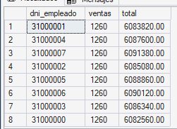
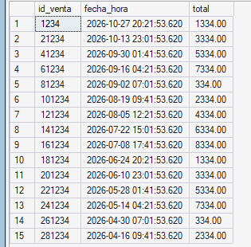

# Índices (Optimización)

## 1. Definición y objetivo

Un **índice** es una estructura auxiliar que permite al motor encontrar filas sin recorrer toda la tabla, como el índice de un libro. Sin índice, para encontrar un dato el motor debe leer **toda la tabla** (*Table Scan*); con un índice adecuado hace una **búsqueda directa** (*Index Seek*).

| Concepto | Descripción |
|---|---|
| **Índice agrupado (clustered)** | Define el orden físico de la tabla. Solo uno por tabla; se crea con la `PRIMARY KEY`. |
| **Índice no agrupado (nonclustered)** | Estructura separada que apunta a las filas. Puede haber varios por tabla. |
| **`INCLUDE` / índice cubriente** | Agrega columnas al índice para responder la consulta sin volver a leer la tabla. |
| **Index Seek vs. Scan** | *Seek*: búsqueda puntual o por rango (rápido). *Scan*: recorrido completo (lento en tablas grandes). |

**Objetivo:** que las consultas más frecuentes sean rápidas aunque la base crezca.

## 2. Ventajas y aplicaciones

- Reducen drásticamente las lecturas de disco y el tiempo de respuesta de consultas, filtros y `JOIN`.
- SQL Server crea índices automáticamente para `PRIMARY KEY` y `UNIQUE`, pero **no para las `FOREIGN KEY`**: conviene indexarlas, porque son las columnas por las que se unen las tablas.
- **Costo:** cada índice ocupa espacio y hace más lentas las altas, bajas y modificaciones (hay que mantenerlo actualizado). Por eso se indexa solo lo que las consultas realmente usan.

## 3. Implementación en SQL Server Express

Se crean 8 índices no agrupados, elegidos a partir de las consultas de la Etapa IV y de los objetos de la Etapa V:

| Índice | Tabla (columnas) | Consulta que acelera |
|---|---|---|
| `IX_venta_fecha_hora` | `venta (fecha_hora)` + INCLUDE | Reportes de ventas por rango de fechas |
| `IX_venta_dni_cliente` | `venta (dni_cliente)` + INCLUDE | Función de descuento y consulta de clientes frecuentes |
| `IX_venta_dni_empleado_fecha` | `venta (dni_empleado, fecha_hora)` + INCLUDE | Reporte por vendedor |
| `IX_detalle_venta_id_venta` | `detalle_venta (id_venta)` + INCLUDE | Factura y todos los `JOIN` venta–detalle |
| `IX_detalle_venta_id_lote` | `detalle_venta (id_lote)` | Trazabilidad de lotes |
| `IX_lote_producto_vencimiento` | `lote (id_producto, fecha_vencimiento)` + INCLUDE | Stock disponible y control de vencimientos |
| `IX_Producto_id_categoria` | `Producto (id_categoria)` | Reporte de ventas por categoría |
| `IX_Persona_apellido_nombre` | `Persona (apellido, nombre)` | Búsqueda de personas en el mostrador |

```sql
USE Farmacia_Proyecto;  
-- SQL Server crea indices automaticamente para las PRIMARY KEY y UNIQUE,
-- pero NO para las FOREIGN KEY. Estos indices cubren los accesos mas frecuentes
-- de las consultas de la Etapa IV y de los objetos de la Etapa V.

-- Ventas por rango de fechas (reportes). INCLUDE evita volver a la tabla (indice "cubriente").
IF NOT EXISTS (SELECT 1 FROM sys.indexes WHERE name = 'IX_venta_fecha_hora' AND object_id = OBJECT_ID('dbo.venta'))
    CREATE NONCLUSTERED INDEX IX_venta_fecha_hora
        ON dbo.venta (fecha_hora) INCLUDE (dni_empleado, dni_cliente, total);

-- Compras de un cliente (funcion de descuento, consulta de clientes frecuentes)
IF NOT EXISTS (SELECT 1 FROM sys.indexes WHERE name = 'IX_venta_dni_cliente' AND object_id = OBJECT_ID('dbo.venta'))
    CREATE NONCLUSTERED INDEX IX_venta_dni_cliente
        ON dbo.venta (dni_cliente) INCLUDE (total, fecha_hora);

-- Ventas de un vendedor en un periodo (reporte por vendedor)
IF NOT EXISTS (SELECT 1 FROM sys.indexes WHERE name = 'IX_venta_dni_empleado_fecha' AND object_id = OBJECT_ID('dbo.venta'))
    CREATE NONCLUSTERED INDEX IX_venta_dni_empleado_fecha
        ON dbo.venta (dni_empleado, fecha_hora) INCLUDE (total);

-- Renglones de una venta (factura y todos los reportes que unen venta con detalle)
IF NOT EXISTS (SELECT 1 FROM sys.indexes WHERE name = 'IX_detalle_venta_id_venta' AND object_id = OBJECT_ID('dbo.detalle_venta'))
    CREATE NONCLUSTERED INDEX IX_detalle_venta_id_venta
        ON dbo.detalle_venta (id_venta) INCLUDE (id_lote, cantidad, precio_unitario);

-- Ventas que consumieron un lote (trazabilidad de lotes)
IF NOT EXISTS (SELECT 1 FROM sys.indexes WHERE name = 'IX_detalle_venta_id_lote' AND object_id = OBJECT_ID('dbo.detalle_venta'))
    CREATE NONCLUSTERED INDEX IX_detalle_venta_id_lote
        ON dbo.detalle_venta (id_lote);

-- Lotes de un producto ordenados por vencimiento (stock disponible, control de vencimientos)
IF NOT EXISTS (SELECT 1 FROM sys.indexes WHERE name = 'IX_lote_producto_vencimiento' AND object_id = OBJECT_ID('dbo.lote'))
    CREATE NONCLUSTERED INDEX IX_lote_producto_vencimiento
        ON dbo.lote (id_producto, fecha_vencimiento) INCLUDE (stock);

-- Reporte de ventas por categoria
IF NOT EXISTS (SELECT 1 FROM sys.indexes WHERE name = 'IX_Producto_id_categoria' AND object_id = OBJECT_ID('dbo.Producto'))
    CREATE NONCLUSTERED INDEX IX_Producto_id_categoria
        ON dbo.Producto (id_categoria);

-- Busqueda de personas por apellido y nombre en el mostrador
IF NOT EXISTS (SELECT 1 FROM sys.indexes WHERE name = 'IX_Persona_apellido_nombre' AND object_id = OBJECT_ID('dbo.Persona'))
    CREATE NONCLUSTERED INDEX IX_Persona_apellido_nombre
        ON dbo.Persona (apellido, nombre);
GO

-- Verificacion: indices creados
SELECT OBJECT_NAME(object_id) AS tabla, name AS indice, type_desc AS tipo
FROM sys.indexes
WHERE name LIKE 'IX[_]%'
ORDER BY tabla, indice;
GO
```

## 4. Caso concreto aplicado al sistema de ventas

Las tablas que más crecen en una farmacia son `venta` y `detalle_venta`: se agregan registros todos los días. Las consultas que se repiten constantemente (la factura, el reporte de ventas de un período, el historial de compras de un cliente) filtran por **fecha**, **cliente** y **venta**. Sin índices, cada una de esas consultas recorre toda la tabla y se vuelve más lenta a medida que pasan los meses; con los índices propuestos, el tiempo se mantiene bajo.

## 5. Script de demostración y resultados

Las tablas reales tienen pocos registros de prueba, y con tan pocos datos los índices casi no se notan. Por eso la demostración crea tablas de prueba con volumen (`perf_venta`: 300.000 ventas y `perf_detalle`: 900.000 renglones), mide tres consultas **sin índices** y **con índices**, y al final elimina las tablas de prueba. Se usa `SET STATISTICS IO/TIME ON` (lecturas lógicas y tiempo) y el **plan de ejecución real** (Ctrl+M en SSMS).

### `sql/tecnico/indices/demo_rendimiento.sql`

```sql
USE Farmacia_Proyecto;
GO
-- Las tablas reales tienen pocos registros, donde los indices casi no se notan.
-- Por eso se crean tablas de prueba con volumen (perf_venta y perf_detalle) y se compara:
--   a) las consultas SIN indices (solo la clave primaria)
--   b) las mismas consultas CON indices
-- Activar "Incluir plan de ejecucion real" (Ctrl+M) para ver Table Scan vs Index Seek.

-- ---------- 1) Tablas y datos de prueba (300.000 ventas, 900.000 renglones) ----------
IF OBJECT_ID('dbo.perf_detalle') IS NOT NULL DROP TABLE dbo.perf_detalle;
IF OBJECT_ID('dbo.perf_venta')   IS NOT NULL DROP TABLE dbo.perf_venta;

CREATE TABLE dbo.perf_venta
(
    id_venta     INT           NOT NULL PRIMARY KEY,
    fecha_hora   DATETIME      NOT NULL,
    total        DECIMAL(10,2) NOT NULL,
    dni_cliente  VARCHAR(15)   NULL,
    dni_empleado VARCHAR(15)   NOT NULL
);
CREATE TABLE dbo.perf_detalle
(
    id_detalle      INT IDENTITY(1,1) PRIMARY KEY,
    id_venta        INT           NOT NULL,
    id_lote         INT           NOT NULL,
    cantidad        INT           NOT NULL,
    precio_unitario DECIMAL(10,2) NOT NULL
);
GO

;WITH n AS (
    SELECT TOP (300000) CAST(ROW_NUMBER() OVER (ORDER BY (SELECT NULL)) AS INT) AS n
    FROM sys.all_objects a CROSS JOIN sys.all_objects b
)
INSERT INTO dbo.perf_venta (id_venta, fecha_hora, total, dni_cliente, dni_empleado)
SELECT n,
       DATEADD(MINUTE, -(n % 525600), GETDATE()),                 -- repartidas en el ultimo anio
       (n % 9000) + 100,
       CAST(30000000 + (n % 20000) AS VARCHAR(15)),
       CAST(31000000 + (n % 8)     AS VARCHAR(15))
FROM n;

INSERT INTO dbo.perf_detalle (id_venta, id_lote, cantidad, precio_unitario)
SELECT v.id_venta, 1 + ((v.id_venta + t.k) % 10), 1 + (v.id_venta % 3), 500 + (v.id_venta % 5000)
FROM dbo.perf_venta v
CROSS JOIN (VALUES (1), (2), (3)) AS t(k);
GO

-- ---------- 2) Consultas SIN indices ----------
SET STATISTICS IO ON;
SET STATISTICS TIME ON;

DECLARE @desde DATETIME = DATEADD(DAY, -30, GETDATE()), @hasta DATETIME = DATEADD(DAY, -23, GETDATE());

PRINT '--- SIN INDICE: ventas de una semana agrupadas por vendedor ---';
SELECT dni_empleado, COUNT(*) AS ventas, SUM(total) AS total
FROM dbo.perf_venta
WHERE fecha_hora >= @desde AND fecha_hora < @hasta
GROUP BY dni_empleado
OPTION (RECOMPILE);

PRINT '--- SIN INDICE: compras de un cliente ---';
SELECT id_venta, fecha_hora, total FROM dbo.perf_venta WHERE dni_cliente = '30001234';

PRINT '--- SIN INDICE: renglones de una venta ---';
SELECT id_detalle, id_lote, cantidad, precio_unitario FROM dbo.perf_detalle WHERE id_venta = 123456;
GO

-- ---------- 3) Creacion de los indices ----------
CREATE NONCLUSTERED INDEX IX_perf_venta_fecha   ON dbo.perf_venta (fecha_hora)  INCLUDE (dni_empleado, total);
CREATE NONCLUSTERED INDEX IX_perf_venta_cliente ON dbo.perf_venta (dni_cliente) INCLUDE (fecha_hora, total);
CREATE NONCLUSTERED INDEX IX_perf_detalle_venta ON dbo.perf_detalle (id_venta)  INCLUDE (id_lote, cantidad, precio_unitario);
GO

-- ---------- 4) Las mismas consultas CON indices ----------
SET STATISTICS IO ON;
SET STATISTICS TIME ON;

DECLARE @desde DATETIME = DATEADD(DAY, -30, GETDATE()), @hasta DATETIME = DATEADD(DAY, -23, GETDATE());

PRINT '--- CON INDICE: ventas de una semana agrupadas por vendedor ---';
SELECT dni_empleado, COUNT(*) AS ventas, SUM(total) AS total
FROM dbo.perf_venta
WHERE fecha_hora >= @desde AND fecha_hora < @hasta
GROUP BY dni_empleado
OPTION (RECOMPILE);

PRINT '--- CON INDICE: compras de un cliente ---';
SELECT id_venta, fecha_hora, total FROM dbo.perf_venta WHERE dni_cliente = '30001234';

PRINT '--- CON INDICE: renglones de una venta ---';
SELECT id_detalle, id_lote, cantidad, precio_unitario FROM dbo.perf_detalle WHERE id_venta = 123456;
GO

SET STATISTICS IO OFF;
SET STATISTICS TIME OFF;

-- ---------- 5) Limpieza de las tablas de prueba ----------
DROP TABLE dbo.perf_detalle;
DROP TABLE dbo.perf_venta;
GO
```
**Índices creados en el sistema real** (consulta de verificación sobre `sys.indexes`):

)

Las filas `perf_venta` y `perf_detalle` corresponden a los índices de las tablas de prueba de la demo, y `backup_metadata_store` es una tabla interna de SQL Server. Los 8 índices del sistema son los de `detalle_venta`, `lote`, `Persona`, `Producto` y `venta`.
### Resultados obtenidos

* **Resultado de la consulta: Ventas de una semana agrupadas por vendedor**
  [Ventas por vendedor]()

  * **Resultado de la consulta: Compras de un cliente específico**
  [Compras de un cliente]()

  * **Resultado de la consulta: Renglones de una venta (`id_venta = 123456`)**
  )

### Resultado esperado

| Consulta | Sin índice | Con índice |
|---|---|---|
| Ventas de una semana por vendedor | `perf_venta`: **1.944** lecturas lógicas | `perf_venta`: **53** lecturas lógicas |
| Compras de un cliente | `perf_venta`: **1.944** lecturas lógicas | `perf_venta`: **3** lecturas lógicas |
| Renglones de una venta | `perf_detalle`: **3.797** lecturas lógicas | `perf_detalle`: **3** lecturas lógicas |

Las lecturas lógicas (`logical reads`) bajaron de forma drástica en las tres consultas al implementar los índices no agrupados y los campos `INCLUDE`, demostrando la optimización frente al recorrido completo de las tablas de prueba.