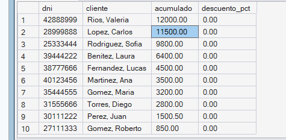
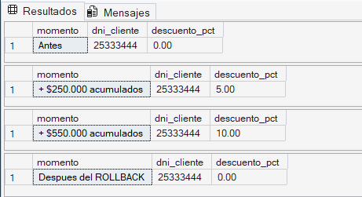
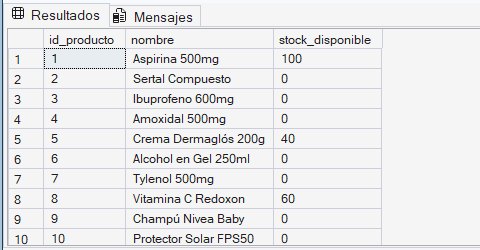
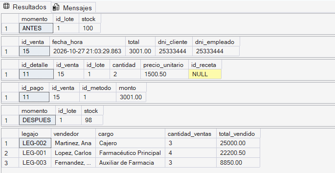

# Procedimientos y Funciones Almacenadas

## 1. Definición y objetivo

Un **procedimiento almacenado** (*stored procedure*) es un programa SQL que se guarda dentro de la base de datos con un nombre y se ejecuta con una sola instrucción (`EXEC`). Puede recibir parámetros, ejecutar muchas operaciones (consultas, inserciones, actualizaciones) y devolver resultados.

Una **función almacenada** (*function*) es una rutina que recibe parámetros y **devuelve un valor** (función escalar) o **una tabla** (función de tabla). A diferencia del procedimiento, se puede usar dentro de un `SELECT`, como si fuera una columna más.

| | Procedimiento | Función |
|---|---|---|
| Se invoca con | `EXEC` | dentro de una consulta (`SELECT dbo.fn(...)`) |
| Devuelve | conjuntos de resultados y parámetros de salida | un valor o una tabla |
| Puede modificar datos | Sí | No (solo consulta) |
| Uso típico | procesos completos (registrar una venta) | cálculos reutilizables (descuentos, stock) |

**Objetivo:** concentrar la lógica de negocio dentro de la base de datos para que todas las aplicaciones y usuarios la usen de la misma forma.

## 2. Ventajas y aplicaciones

- **Reutilización:** la lógica se escribe una vez y se invoca desde cualquier lugar.
- **Menos código repetido y más mantenibilidad:** si cambia una regla (por ejemplo, el porcentaje de descuento), se modifica en un solo objeto.
- **Centralización de reglas de negocio:** las reglas RN.01, RN.02, RN.04 y RN.06 se validan siempre, sin depender de que cada programa las recuerde.
- **Seguridad:** se puede permitir que un usuario ejecute el procedimiento sin darle acceso directo a las tablas (ver `seguridad.md`).
- **Rendimiento:** una sola llamada reemplaza varias consultas enviadas por separado, y el motor reutiliza el plan de ejecución.

## 3. Implementación en SQL Server Express

Objetos creados:

| Objeto | Tipo | Qué hace |
|---|---|---|
| `dbo.fn_CalcularDescuentoCliente` | Función escalar | Devuelve el % de descuento según lo acumulado en compras del cliente |
| `dbo.fn_StockDisponible` | Función escalar | Suma el stock de los lotes **no vencidos** de un producto |
| `dbo.tipo_detalle_venta` | Tipo tabla | Permite enviar todos los renglones de una venta en un solo parámetro |
| `dbo.sp_RegistrarVentaCompleta` | Procedimiento | Registra encabezado, detalle, stock, total y pago en una única operación |
| `dbo.sp_ReporteVentasPorVendedor` | Procedimiento | Reporte de ventas por vendedor en un rango de fechas (consulta 2.a de la Etapa IV) |

**Orden de ejecución:** primero las funciones (`sql/tecnico/funciones/`) y luego los procedimientos (`sql/tecnico/procedimientos/`), porque el procedimiento de venta usa la función de descuento.

### Función: descuento para clientes frecuentes

```sql
USE Farmacia_Proyecto;
GO
-- Devuelve el porcentaje de descuento segun el monto acumulado de compras del cliente.
--   Mas de $500.000 acumulados -> 10 %
--   Mas de $200.000 acumulados ->  5 %
--   Caso contrario             ->  0 %
CREATE OR ALTER FUNCTION dbo.fn_CalcularDescuentoCliente (@dni_cliente INT)
RETURNS DECIMAL(5,2)
AS
BEGIN
    DECLARE @acumulado DECIMAL(14,2);

    SELECT @acumulado = ISNULL(SUM(total), 0)
    FROM dbo.venta
    WHERE dni_cliente = @dni_cliente;

    RETURN CASE
               WHEN @acumulado > 500000 THEN 10.00
               WHEN @acumulado > 200000 THEN  5.00
               ELSE 0.00
           END;
END;
GO
```

### Función: stock disponible

```sql
USE Farmacia_Proyecto;
GO
-- El stock se guarda por lote (RN.02). Esta funcion suma el stock de los lotes
-- NO vencidos de un producto, es decir, lo que realmente se puede vender hoy.
CREATE OR ALTER FUNCTION dbo.fn_StockDisponible (@id_producto INT)
RETURNS INT
AS
BEGIN
    RETURN ISNULL((SELECT SUM(stock)
                   FROM dbo.lote
                   WHERE id_producto = @id_producto
                     AND fecha_vencimiento >= CAST(GETDATE() AS DATE)), 0);
END;
GO
```

### Procedimiento: registrar una venta completa

```sql
USE Farmacia_Proyecto;
GO
-- Requiere que exista dbo.fn_CalcularDescuentoCliente (ejecutar primero la carpeta funciones).

-- Tipo de tabla para enviar los renglones de la venta en una sola llamada (parametro tipo tabla).
IF TYPE_ID('dbo.tipo_detalle_venta') IS NULL
    CREATE TYPE dbo.tipo_detalle_venta AS TABLE
    (
        id_lote   INT NOT NULL,
        cantidad  INT NOT NULL CHECK (cantidad > 0),
        id_receta INT NULL
    );
GO

CREATE OR ALTER PROCEDURE dbo.sp_RegistrarVentaCompleta
    @dni_empleado INT,
    @id_metodo    INT,
    @detalle      dbo.tipo_detalle_venta READONLY,
    @dni_cliente  INT         = NULL,      -- NULL = consumidor final (se resuelve al cliente generico)
    @id_venta     INT OUTPUT
AS
BEGIN
    SET NOCOUNT ON;
    SET XACT_ABORT ON;

    DECLARE @descuento DECIMAL(5,2) = 0,
            @total     DECIMAL(12,2),
            @lotes     INT,
            @filas     INT;

    BEGIN TRY
        BEGIN TRANSACTION;

        -- ---------- Consumidor final ----------
        -- venta.dni_cliente es NOT NULL (FK a cliente). Si no se indica cliente,
        -- se usa el cliente generico "Consumidor Final" (dni 99999999).
        IF @dni_cliente IS NULL
        BEGIN
            IF NOT EXISTS (SELECT 1 FROM dbo.Cliente WHERE dni = 99999999)
                THROW 50009, 'Consumidor final sin registrar: falta el cliente generico dni 99999999 en los datos de prueba.', 1;
            SET @dni_cliente = 99999999;
        END;

        -- ---------- Validaciones de entrada ----------
        IF NOT EXISTS (SELECT 1 FROM @detalle)
            THROW 50001, 'La venta no tiene renglones.', 1;

        IF NOT EXISTS (SELECT 1 FROM dbo.Empleado WHERE dni = @dni_empleado)
            THROW 50002, 'El vendedor indicado no existe.', 1;

        IF @dni_cliente IS NOT NULL
           AND NOT EXISTS (SELECT 1 FROM dbo.Cliente WHERE dni = @dni_cliente)
            THROW 50003, 'El cliente indicado no esta registrado.', 1;

        IF NOT EXISTS (SELECT 1 FROM dbo.Metodo_Pago WHERE id_metodo = @id_metodo)
            THROW 50004, 'El metodo de pago indicado no existe.', 1;

        IF EXISTS (SELECT 1 FROM @detalle d
                   LEFT JOIN dbo.lote l ON l.id_lote = d.id_lote
                   WHERE l.id_lote IS NULL)
            THROW 50005, 'Alguno de los lotes indicados no existe.', 1;

        -- RN.02: no se vende un lote vencido
        IF EXISTS (SELECT 1 FROM @detalle d
                   JOIN dbo.lote l ON l.id_lote = d.id_lote
                   WHERE l.fecha_vencimiento < CAST(GETDATE() AS DATE))
            THROW 50006, 'No se puede vender un lote vencido.', 1;

        -- RN.06: un producto bajo receta exige el dato de la receta
        IF EXISTS (SELECT 1 FROM @detalle d
                   JOIN dbo.lote l ON l.id_lote = d.id_lote
                   JOIN dbo.Producto p ON p.id_producto = l.id_producto
                   WHERE p.requiere_receta = 1 AND d.id_receta IS NULL)
            THROW 50007, 'Un producto bajo receta requiere el numero de receta.', 1;

        -- ---------- Descuento por cliente frecuente ----------
        IF @dni_cliente IS NOT NULL
            SET @descuento = dbo.fn_CalcularDescuentoCliente(@dni_cliente);

        -- ---------- 1) Encabezado de la venta ----------
        INSERT INTO dbo.venta (fecha_hora, total, dni_cliente, dni_empleado)
        VALUES (GETDATE(), 0, @dni_cliente, @dni_empleado);

        SET @id_venta = SCOPE_IDENTITY();

        -- ---------- 2) Detalle con precio historico (RN.04) ----------
        -- El descuento se refleja en el precio_unitario efectivamente cobrado, asi
        -- venta.total sigue siendo igual a la suma de los renglones.
        INSERT INTO dbo.detalle_venta (id_venta, id_lote, cantidad, precio_unitario, id_receta)
        SELECT @id_venta, d.id_lote, d.cantidad,
               ROUND(p.precio * (1 - @descuento / 100.0), 2),
               d.id_receta
        FROM @detalle d
        JOIN dbo.lote l     ON l.id_lote = d.id_lote
        JOIN dbo.Producto p ON p.id_producto = l.id_producto;

        -- ---------- 3) Descuento de stock (RN.01) ----------
        -- UPDATE condicionado: solo descuenta si alcanza el stock. Es atomico, por lo
        -- que dos ventas simultaneas no pueden vender la misma ultima unidad.
        SELECT @lotes = COUNT(DISTINCT id_lote) FROM @detalle;

        UPDATE l
           SET l.stock = l.stock - x.cant
        FROM dbo.lote l
        JOIN (SELECT id_lote, SUM(cantidad) AS cant
              FROM @detalle
              GROUP BY id_lote) x ON x.id_lote = l.id_lote
        WHERE l.stock >= x.cant;

        SET @filas = @@ROWCOUNT;

        IF @filas <> @lotes
            THROW 50008, 'Stock insuficiente en alguno de los lotes. Venta cancelada.', 1;

        -- ---------- 4) Total de la venta ----------
        SELECT @total = SUM(cantidad * precio_unitario)
        FROM dbo.detalle_venta
        WHERE id_venta = @id_venta;

        UPDATE dbo.venta SET total = @total WHERE id_venta = @id_venta;

        -- ---------- 5) Pago (RN.05) ----------
        INSERT INTO dbo.pago (id_venta, id_metodo, monto)
        VALUES (@id_venta, @id_metodo, @total);

        -- ---------- 6) Confirmar ----------
        COMMIT TRANSACTION;
    END TRY
    BEGIN CATCH
        IF @@TRANCOUNT > 0 ROLLBACK TRANSACTION;
        SET @id_venta = NULL;
        THROW;   -- vuelve a lanzar el error original al que llamo
    END CATCH
END;
GO
```

### Procedimiento: reporte por vendedor

```sql
USE Farmacia_Proyecto;
GO
-- Es la consulta 2.a de la Etapa IV convertida en procedimiento con parametros.
CREATE OR ALTER PROCEDURE dbo.sp_ReporteVentasPorVendedor
    @desde DATE,
    @hasta DATE
AS
BEGIN
    SET NOCOUNT ON;

    SELECT e.legajo,
           pe.apellido + ', ' + pe.nombre         AS vendedor,
           ca.descripcion                          AS cargo,
           COUNT(DISTINCT v.id_venta)              AS cantidad_ventas,
           SUM(dv.cantidad * dv.precio_unitario)   AS total_vendido
    FROM dbo.venta v
    JOIN dbo.detalle_venta dv ON dv.id_venta = v.id_venta
    JOIN dbo.Empleado e       ON e.dni = v.dni_empleado
    JOIN dbo.Persona pe       ON pe.dni = e.dni
    JOIN dbo.cargo ca         ON ca.id_cargo = e.id_cargo
    WHERE v.fecha_hora >= @desde
      AND v.fecha_hora <  DATEADD(DAY, 1, @hasta)   -- incluye todo el ultimo dia
    GROUP BY e.legajo, pe.apellido, pe.nombre, ca.descripcion
    ORDER BY total_vendido DESC;
END;
GO
```

## 4. Caso concreto aplicado al sistema de ventas

**Problema de negocio:** registrar una venta completa sin que el usuario tenga que ejecutar muchas consultas, cumpliendo las reglas de negocio y premiando a los clientes frecuentes.

`sp_RegistrarVentaCompleta` recibe el vendedor, el método de pago, el cliente (opcional: si es `NULL` se resuelve al cliente genérico Consumidor Final, dni 99999999, RN.03) y los renglones de la venta, y realiza **en una única transacción**:

1. Valida los datos y las reglas: lote vencido (RN.02) y producto bajo receta sin receta (RN.06).
2. Calcula el descuento del cliente con `fn_CalcularDescuentoCliente`.
3. Inserta el encabezado en `venta`.
4. Inserta los renglones en `detalle_venta` guardando el **precio histórico** (RN.04).
5. Descuenta el stock del lote (RN.01) con un `UPDATE` condicionado: solo descuenta si alcanza.
6. Calcula el total y registra el `pago` (RN.05).
7. Confirma con `COMMIT`; ante cualquier error hace `ROLLBACK`.

**Decisiones de diseño:**

- El modelo no tiene una columna de descuento, por lo que el descuento se refleja en el `precio_unitario` efectivamente cobrado. Así `venta.total` sigue siendo igual a la suma de los renglones y la consulta de control de la Etapa IV sigue sin mostrar diferencias.
- El stock se controla por **lote** (donde está guardado en el modelo), no por producto.
- Los renglones se envían con un **parámetro de tipo tabla**, lo que permite vender varios productos en una sola llamada.
- Los umbrales de la función de descuento ($200.000 y $500.000) son los de la guía de la cátedra; se pueden ajustar editando la función.

## 5. Script de demostración y resultados

### Funciones (`sql/tecnico/funciones/demo_funciones.sql`)

```sql
USE Farmacia_Proyecto;
GO
SET NOCOUNT ON;

-- 1) Descuento actual de cada cliente (segun lo que ya compro)
SELECT c.dni,
       p.apellido + ', ' + p.nombre AS cliente,
       ISNULL((SELECT SUM(v.total) FROM dbo.venta v WHERE v.dni_cliente = c.dni), 0) AS acumulado,
       dbo.fn_CalcularDescuentoCliente(c.dni) AS descuento_pct
FROM dbo.Cliente c
JOIN dbo.Persona p ON p.dni = c.dni
ORDER BY acumulado DESC;

-- 2) Simulacion: se agregan compras grandes a un cliente y se observa el descuento.
--    Todo se hace dentro de una transaccion que se deshace al final (no deja datos).
DECLARE @dni INT = (SELECT TOP 1 dni FROM dbo.Cliente  ORDER BY dni);
DECLARE @emp INT = (SELECT TOP 1 dni FROM dbo.Empleado ORDER BY dni);

SELECT 'Antes' AS momento, @dni AS dni_cliente, dbo.fn_CalcularDescuentoCliente(@dni) AS descuento_pct;

BEGIN TRANSACTION;

    INSERT INTO dbo.venta (fecha_hora, total, dni_cliente, dni_empleado)
    VALUES (GETDATE(), 250000, @dni, @emp);
    SELECT '+ $250.000 acumulados' AS momento, @dni AS dni_cliente,
           dbo.fn_CalcularDescuentoCliente(@dni) AS descuento_pct;

    INSERT INTO dbo.venta (fecha_hora, total, dni_cliente, dni_empleado)
    VALUES (GETDATE(), 300000, @dni, @emp);
    SELECT '+ $550.000 acumulados' AS momento, @dni AS dni_cliente,
           dbo.fn_CalcularDescuentoCliente(@dni) AS descuento_pct;

ROLLBACK TRANSACTION;

SELECT 'Despues del ROLLBACK' AS momento, @dni AS dni_cliente,
       dbo.fn_CalcularDescuentoCliente(@dni) AS descuento_pct;

-- 3) Stock vendible por producto (lotes no vencidos)
SELECT p.id_producto, p.nombre, dbo.fn_StockDisponible(p.id_producto) AS stock_disponible
FROM dbo.Producto p
ORDER BY p.id_producto;
GO
```

### Resultados obtenidos

 `demo_funciones.sql`: 

 1) Descuento actual de cada cliente (segun lo que ya compro)
 

 2) Simulación: se agregan compras grandes a un cliente y se observa el descuento.
 

 3) Stock vendible por producto (lotes no vencidos):
 

### Resultado esperado

- El primer `SELECT` lista a cada cliente con su acumulado de compras y su descuento (con pocos datos de prueba, `0.00` para todos).
- En la simulación el descuento pasa de `0.00` a `5.00` (acumulado > $200.000) y luego a `10.00` (acumulado > $500.000). Tras el `ROLLBACK` vuelve al valor original.
- El último `SELECT` muestra el stock vendible de cada producto (lotes no vencidos).

### Procedimientos (`sql/tecnico/procedimientos/demo_procedimientos.sql`)

```sql
USE Farmacia_Proyecto;
GO
SET NOCOUNT ON;

-- Parametros tomados de datos reales de la base
DECLARE @dni_empleado INT = (SELECT TOP 1 dni FROM dbo.Empleado ORDER BY dni);
DECLARE @dni_cliente  INT = (SELECT TOP 1 dni FROM dbo.Cliente  ORDER BY dni);
DECLARE @id_metodo    INT         = (SELECT TOP 1 id_metodo FROM dbo.Metodo_Pago ORDER BY id_metodo);
DECLARE @id_lote      INT         = (SELECT TOP 1 l.id_lote
                                     FROM dbo.lote l
                                     JOIN dbo.Producto p ON p.id_producto = l.id_producto
                                     WHERE l.stock >= 3
                                       AND l.fecha_vencimiento >= CAST(GETDATE() AS DATE)
                                       AND p.requiere_receta = 0
                                     ORDER BY l.id_lote);
DECLARE @id_venta INT;
DECLARE @limpiar  BIT = 1;      -- 1 = deshace la venta de prueba al final; 0 = la deja registrada

IF @id_lote IS NULL
BEGIN
    PRINT 'No hay un lote vigente con stock suficiente para la prueba.';
    RETURN;
END;

-- Renglones de la venta (dos unidades del lote elegido)
DECLARE @items dbo.tipo_detalle_venta;
INSERT INTO @items (id_lote, cantidad, id_receta) VALUES (@id_lote, 2, NULL);

SELECT 'ANTES' AS momento, id_lote, stock FROM dbo.lote WHERE id_lote = @id_lote;

-- Llamada al procedimiento: una sola instruccion registra toda la venta
EXEC dbo.sp_RegistrarVentaCompleta
     @dni_empleado = @dni_empleado,
     @id_metodo    = @id_metodo,
     @detalle      = @items,
     @dni_cliente  = @dni_cliente,
     @id_venta     = @id_venta OUTPUT;

PRINT 'Venta registrada con id ' + CAST(@id_venta AS VARCHAR(10));

SELECT * FROM dbo.venta         WHERE id_venta = @id_venta;
SELECT * FROM dbo.detalle_venta WHERE id_venta = @id_venta;
SELECT * FROM dbo.pago          WHERE id_venta = @id_venta;
SELECT 'DESPUES' AS momento, id_lote, stock FROM dbo.lote WHERE id_lote = @id_lote;

-- Limpieza de la venta de prueba (devuelve el stock)
IF @limpiar = 1
BEGIN
    DELETE FROM dbo.pago          WHERE id_venta = @id_venta;
    DELETE FROM dbo.detalle_venta WHERE id_venta = @id_venta;
    DELETE FROM dbo.venta         WHERE id_venta = @id_venta;
    UPDATE dbo.lote SET stock = stock + 2 WHERE id_lote = @id_lote;
    PRINT 'Venta de prueba eliminada y stock restituido.';
END;

-- Procedimiento de reporte
EXEC dbo.sp_ReporteVentasPorVendedor @desde = '20260101', @hasta = '20261231';
GO
```

### Resultados obtenidos

`demo_procedimientos.sql` 

1)

### Resultado esperado

- El stock del lote baja en 2 unidades (`ANTES` vs. `DESPUES`).
- Queda **una** fila en `venta`, **una** en `detalle_venta` (cantidad 2, con el precio del producto) y **una** en `pago` cuyo monto coincide con `venta.total`.
- `sp_ReporteVentasPorVendedor` devuelve el total vendido por cada vendedor.
- Con `@limpiar = 1` la venta de prueba se elimina y el stock se restituye al final.

---

