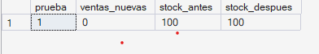
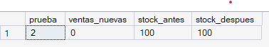
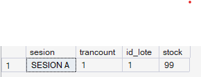
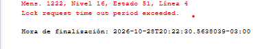
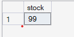
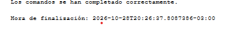
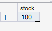

# Manejo de Transacciones

## 1. Definición y objetivo

Una **transacción** es un conjunto de operaciones SQL que se ejecuta como **una única unidad lógica de trabajo**: o se completan todas, o no se aplica ninguna. Si una operación falla, las anteriores se deshacen. Esto garantiza las propiedades **ACID**:

| Propiedad | Significado | Ejemplo en la farmacia |
|---|---|---|
| **A**tomicidad | Todo o nada | O se registran venta, detalle y stock, o no se registra nada |
| **C**onsistencia | La base pasa de un estado válido a otro válido | El stock nunca queda negativo |
| **A**islamiento | Transacciones simultáneas no se interfieren | Dos vendedores no pueden vender la misma última unidad |
| **D**urabilidad | Lo confirmado persiste aunque falle el servidor | Una venta confirmada no se pierde |

**Instrucciones principales en SQL Server:** `BEGIN TRANSACTION` (inicia), `COMMIT TRANSACTION` (confirma), `ROLLBACK TRANSACTION` (deshace), `TRY … CATCH` (captura errores), `THROW` (lanza un error propio) y `@@TRANCOUNT` (cantidad de transacciones abiertas).

## 2. Ventajas y aplicaciones

- Evita **información incompleta o inconsistente** ante fallas (cortes de luz, errores, datos inválidos).
- Permite aplicar reglas de negocio con la garantía de que, si una no se cumple, no queda ningún cambio a medias.
- Es la base de cualquier proceso que toque varias tablas: ventas, devoluciones, ingreso de lotes.

## 3. Implementación en SQL Server Express

Una venta involucra varias tablas: `venta`, `detalle_venta`, `lote` (donde se guarda el stock) y `pago`. Se implementa con el patrón:

```
BEGIN TRY
    BEGIN TRANSACTION
        -- 1) crear venta   2) crear detalle   3) descontar stock (si no alcanza: THROW)
    COMMIT TRANSACTION
END TRY
BEGIN CATCH
    ROLLBACK TRANSACTION   -- se deshace todo
END CATCH
```

El mismo patrón está incorporado dentro de `sp_RegistrarVentaCompleta` (ver `procedimientos-funciones.md`), que además usa `SET XACT_ABORT ON` para que cualquier error de ejecución cancele la transacción.

El control de stock se hace con un `UPDATE` condicionado (`WHERE stock >= @cantidad`): si no se modifica ninguna fila, el stock era insuficiente y se lanza un error. Esta forma es atómica y soporta el **aislamiento**: si dos vendedores intentan vender la última unidad al mismo tiempo, solo uno logra descontarla.

SQL Server usa por defecto el nivel de aislamiento `READ COMMITTED`: mientras una transacción modifica una fila sin confirmar, ninguna otra sesión puede leer ese dato (queda esperando el bloqueo). Esto evita las **lecturas sucias**, es decir, leer cambios que después podrían deshacerse con un `ROLLBACK`.

## 4. Caso concreto aplicado al sistema de ventas

**Escenario:** un cliente compra unidades de un producto. La operación debe (1) crear la venta, (2) crear el detalle y (3) descontar stock.

**Si no hay stock suficiente:** no se registra la venta, no se registra el detalle y no se modifica el stock (RN.01).

Se realizan dos pruebas sobre el mismo lote:

| Prueba | Cantidad | Resultado esperado |
|---|---|---|
| 1 – Correcta | 2 unidades (stock suficiente) | `COMMIT`: venta registrada y stock descontado |
| 2 – Incorrecta | stock + 1 (stock insuficiente) | `ROLLBACK`: no queda ningún registro parcial |

La prueba 2 es la que demuestra la **atomicidad**: la venta y el detalle ya habían sido insertados cuando se detectó la falta de stock, y aun así el `ROLLBACK` los deshace.

## 5. Script de demostración y resultados

### 5.1 Atomicidad: `sql/tecnico/transacciones/demo_transacciones.sql`

```sql
USE FarmaciaDB;   -- reemplazar por el nombre real de la base
GO
-- Se ejecutan dos pruebas sobre el mismo lote:
--   PRUEBA 1: cantidad con stock suficiente   -> COMMIT  (venta registrada, stock descontado)
--   PRUEBA 2: cantidad mayor al stock         -> ROLLBACK (no queda ningun registro parcial)
SET NOCOUNT ON;

DECLARE @dni_empleado VARCHAR(15) = (SELECT TOP 1 dni FROM dbo.Empleado ORDER BY dni);
DECLARE @id_lote      INT         = (SELECT TOP 1 l.id_lote
                                     FROM dbo.lote l
                                     JOIN dbo.Producto p ON p.id_producto = l.id_producto
                                     WHERE l.stock >= 5
                                       AND l.fecha_vencimiento >= CAST(GETDATE() AS DATE)
                                       AND p.requiere_receta = 0
                                     ORDER BY l.id_lote);
DECLARE @limpiar BIT = 1;       -- 1 = al final deshace la venta de la prueba 1 (restituye stock)

IF @id_lote IS NULL
BEGIN
    PRINT 'No hay un lote vigente con stock >= 5 para la prueba.';
    RETURN;
END;

DECLARE @i INT = 1, @cantidad INT, @id_venta INT, @id_venta_ok INT,
        @stock_antes INT, @ventas_antes INT;

WHILE @i <= 2
BEGIN
    SELECT @stock_antes  = stock    FROM dbo.lote WHERE id_lote = @id_lote;
    SELECT @ventas_antes = COUNT(*) FROM dbo.venta;
    SET @cantidad = CASE WHEN @i = 1 THEN 2 ELSE @stock_antes + 1 END;

    PRINT '--- PRUEBA ' + CAST(@i AS VARCHAR(1)) + ': venta de ' + CAST(@cantidad AS VARCHAR(10))
        + ' unidades del lote ' + CAST(@id_lote AS VARCHAR(10))
        + ' (stock actual: ' + CAST(@stock_antes AS VARCHAR(10)) + ')';

    BEGIN TRY
        BEGIN TRANSACTION;

            -- 1) Crear la venta
            INSERT INTO dbo.venta (fecha_hora, total, dni_cliente, dni_empleado)
            VALUES (GETDATE(), 0, NULL, @dni_empleado);
            SET @id_venta = SCOPE_IDENTITY();

            -- 2) Crear el detalle (precio historico del producto)
            INSERT INTO dbo.detalle_venta (id_venta, id_lote, cantidad, precio_unitario, id_receta)
            SELECT @id_venta, l.id_lote, @cantidad, p.precio, NULL
            FROM dbo.lote l
            JOIN dbo.Producto p ON p.id_producto = l.id_producto
            WHERE l.id_lote = @id_lote;

            -- 3) Descontar stock (solo si alcanza)
            UPDATE dbo.lote
               SET stock = stock - @cantidad
             WHERE id_lote = @id_lote
               AND stock >= @cantidad;

            IF @@ROWCOUNT = 0
                THROW 50010, 'Stock insuficiente: se cancela la venta.', 1;

            -- 4) Total de la venta
            UPDATE dbo.venta
               SET total = (SELECT SUM(cantidad * precio_unitario)
                            FROM dbo.detalle_venta WHERE id_venta = @id_venta)
             WHERE id_venta = @id_venta;

        COMMIT TRANSACTION;
        SET @id_venta_ok = @id_venta;
        PRINT 'COMMIT: venta ' + CAST(@id_venta AS VARCHAR(10)) + ' registrada.';
    END TRY
    BEGIN CATCH
        IF @@TRANCOUNT > 0 ROLLBACK TRANSACTION;
        PRINT 'ROLLBACK: ' + ERROR_MESSAGE();
    END CATCH;

    -- Estado resultante: ventas nuevas y stock antes/despues
    SELECT @i AS prueba,
           (SELECT COUNT(*) FROM dbo.venta) - @ventas_antes AS ventas_nuevas,
           @stock_antes AS stock_antes,
           (SELECT stock FROM dbo.lote WHERE id_lote = @id_lote) AS stock_despues;

    SET @i += 1;
END;

-- Limpieza opcional de la venta de la prueba 1
IF @limpiar = 1 AND @id_venta_ok IS NOT NULL
BEGIN
    DELETE FROM dbo.detalle_venta WHERE id_venta = @id_venta_ok;
    DELETE FROM dbo.venta         WHERE id_venta = @id_venta_ok;
    UPDATE dbo.lote SET stock = stock + 2 WHERE id_lote = @id_lote;
    PRINT 'Limpieza: venta de prueba eliminada y stock restituido.';
END;
GO
```

#### Resultados obtenidos
`demo_trasacciones.sql`:

1) PRUEBA 1: cantidad con stock suficiente


2) PRUEBA 2: cantidad mayor al stock



#### Resultado esperado

**Prueba 1:** mensaje `COMMIT: venta N registrada.`; en el resumen `ventas_nuevas = 1` y `stock_despues = stock_antes − 2`.

**Prueba 2:** mensaje `ROLLBACK: Stock insuficiente: se cancela la venta.`; en el resumen `ventas_nuevas = 0` y `stock_despues = stock_antes` (sin cambios).

Con `@limpiar = 1`, al final se elimina la venta de la prueba 1 y se restituye el stock, dejando la base como estaba.

### 5.2 Aislamiento: `sql/tecnico/transacciones/demo_aislamiento.sql`

Esta demostración necesita **dos ventanas de consulta** (dos sesiones) abiertas a la vez en SSMS. La sesión A modifica el stock sin confirmar y la sesión B intenta leerlo.

```sql
-- =====================================================================
-- Aislamiento de transacciones: bloqueos entre dos sesiones
-- Proyecto Integrador Bases de Datos 1 - Grupo 9
-- Sistema de Gestion de Ventas para Farmacia
-- Motor: SQL Server Express
-- =====================================================================
-- Abrir DOS ventanas de consulta (dos sesiones) en SSMS y ejecutar cada bloque
-- en la ventana indicada, respetando el orden de los pasos.

-- ---------------------------------------------------------------------
-- PASO 1 - SESION A: abre una transaccion y modifica el stock SIN confirmar
-- ---------------------------------------------------------------------
USE FarmaciaDB;   -- << REEMPLAZAR por el nombre real de la base de datos
GO
BEGIN TRANSACTION;
    UPDATE dbo.lote SET stock = stock - 1 WHERE id_lote = 1;

    SELECT 'SESION A' AS sesion, @@TRANCOUNT AS trancount, id_lote, stock
    FROM dbo.lote WHERE id_lote = 1;
-- (NO ejecutar todavia COMMIT ni ROLLBACK: la transaccion queda abierta)

-- ---------------------------------------------------------------------
-- PASO 2 - SESION B: lectura normal (READ COMMITTED, nivel por defecto)
-- ---------------------------------------------------------------------
USE FarmaciaDB;
GO
SET LOCK_TIMEOUT 5000;          -- espera como maximo 5 segundos
SELECT stock FROM dbo.lote WHERE id_lote = 1;
-- Resultado: la consulta queda esperando y falla con el error 1222
-- (Lock request time out period exceeded): no puede leer un dato sin confirmar.

-- ---------------------------------------------------------------------
-- PASO 3 - SESION B: lectura sucia (NOLOCK), solo para mostrar la diferencia
-- ---------------------------------------------------------------------
SELECT stock FROM dbo.lote WITH (NOLOCK) WHERE id_lote = 1;
-- Resultado: devuelve el stock modificado por A aunque todavia no esta confirmado.

-- ---------------------------------------------------------------------
-- PASO 4 - SESION A: deshacer la transaccion
-- ---------------------------------------------------------------------
ROLLBACK TRANSACTION;

-- ---------------------------------------------------------------------
-- PASO 5 - SESION B: repetir la lectura normal
-- ---------------------------------------------------------------------
SELECT stock FROM dbo.lote WHERE id_lote = 1;
-- Resultado: responde de inmediato con el valor original.
GO
```

#### Resultados obtenidos

`demo_aislamiento.sql`:

1) SESION A: abre una transaccion y modifica el stock SIN confirmar


2) SESION B: lectura normal (READ COMMITTED, nivel por defecto)


3) SESION B: lectura sucia (NOLOCK), solo para mostrar la diferencia


4) SESION A: deshacer la transaccion


5) SESION B: repetir la lectura normal



#### Resultado esperado

| Paso | Sesión | Resultado |
|---|---|---|
| 1 | A | `trancount = 1` y el stock del lote 1 con una unidad menos (sin confirmar) |
| 2 | B (lectura normal) | Queda esperando y a los 5 segundos falla con el error 1222 (*Lock request time out period exceeded*): no puede ver un dato sin confirmar |
| 3 | B (`WITH (NOLOCK)`) | Lee el stock modificado por A (lectura sucia); se muestra para contrastar y **no se recomienda** en ventas |
| 4 | A | `ROLLBACK`: se deshace el cambio |
| 5 | B (lectura normal) | Responde de inmediato con el stock original |

Esto demuestra el **aislamiento**: una transacción no expone sus cambios a otras sesiones hasta que se confirman con `COMMIT`.

---
*Proyecto Integrador Bases de Datos 1 – Grupo 9 – Sistema de Gestión de Ventas para Farmacia – Motor: SQL Server Express.*