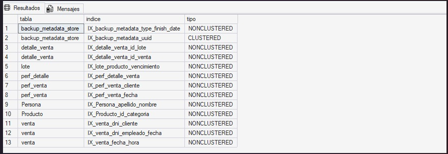
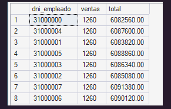
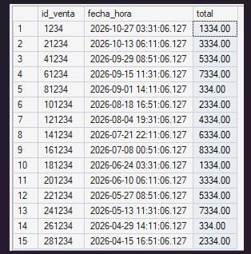
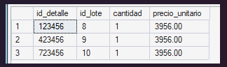

# Índices (Optimización)

## 1. Definición y objetivo

Un **índice** es una estructura auxiliar que permite al motor encontrar filas sin recorrer toda la tabla, como el índice de un libro. Sin índice, para encontrar un dato el motor debe leer **toda la tabla** (*Table Scan*); con un índice adecuado hace una **búsqueda directa** (*Index Seek*).

| Concepto | Descripción |
|---|---|
| **Índice agrupado (clustered)** | Define el orden físico de la tabla. Solo uno por tabla; se crea con la `PRIMARY KEY`. |
| **Índice no agrupado (nonclustered)** | Estructura separada que apunta a las filas. Puede haber varios por tabla. |
| **`INCLUDE` / índice cubriente** | Agrega columnas al índice para responder la consulta sin volver a leer la tabla. |
| **Index Seek vs. Scan** | *Seek*: búsqueda puntual o por rango (rápido). *Scan*: recorrido completo (lento en tablas grandes). |

**Objetivo:** que las consultas más frecuentes sean rápidas aunque la base crezca.

## 2. Ventajas y aplicaciones

- Reducen drásticamente las lecturas de disco y el tiempo de respuesta de consultas, filtros y `JOIN`.
- SQL Server crea índices automáticamente para `PRIMARY KEY` y `UNIQUE`, pero **no para las `FOREIGN KEY`**: conviene indexarlas, porque son las columnas por las que se unen las tablas.
- **Costo:** cada índice ocupa espacio y hace más lentas las altas, bajas y modificaciones (hay que mantenerlo actualizado). Por eso se indexa solo lo que las consultas realmente usan.

## 3. Implementación en SQL Server Express

Se crean 8 índices no agrupados, elegidos a partir de las consultas de la Etapa IV y de los objetos de la Etapa V:

| Índice | Tabla (columnas) | Consulta que acelera |
|---|---|---|
| `IX_venta_fecha_hora` | `venta (fecha_hora)` + INCLUDE | Reportes de ventas por rango de fechas |
| `IX_venta_dni_cliente` | `venta (dni_cliente)` + INCLUDE | Función de descuento y consulta de clientes frecuentes |
| `IX_venta_dni_empleado_fecha` | `venta (dni_empleado, fecha_hora)` + INCLUDE | Reporte por vendedor |
| `IX_detalle_venta_id_venta` | `detalle_venta (id_venta)` + INCLUDE | Factura y todos los `JOIN` venta–detalle |
| `IX_detalle_venta_id_lote` | `detalle_venta (id_lote)` | Trazabilidad de lotes |
| `IX_lote_producto_vencimiento` | `lote (id_producto, fecha_vencimiento)` + INCLUDE | Stock disponible y control de vencimientos |
| `IX_Producto_id_categoria` | `Producto (id_categoria)` | Reporte de ventas por categoría |
| `IX_Persona_apellido_nombre` | `Persona (apellido, nombre)` | Búsqueda de personas en el mostrador |

Los `dni` del modelo son `INT`, por lo que las tablas de prueba del demo también usan `INT` para `dni_cliente` y `dni_empleado`.

## 4. Caso concreto aplicado al sistema de ventas

Las tablas que más crecen en una farmacia son `venta` y `detalle_venta`: se agregan registros todos los días. Las consultas que se repiten constantemente (la factura, el reporte de ventas de un período, el historial de compras de un cliente) filtran por **fecha**, **cliente** y **venta**. Sin índices, cada una de esas consultas recorre toda la tabla y se vuelve más lenta a medida que pasan los meses; con los índices propuestos, el tiempo se mantiene bajo.

## 5. Cómo ejecutar la demostración

1. Tener creada y cargada la base `Farmacia_Proyecto` con el DDL y el DML del proyecto.
2. Abrir `scripts.sql` en SQL Server Management Studio.
3. Ejecutar la **sección 1**: crea los 8 índices sobre las tablas reales y muestra la verificación desde `sys.indexes`.
4. Ejecutar la **sección 2**: crea `perf_venta` (300.000 ventas) y `perf_detalle` (900.000 renglones), mide las consultas sin índices, crea tres índices de prueba, repite las consultas y elimina las tablas de prueba.
5. Activar **Incluir plan de ejecución real** (`Ctrl+M`) antes de ejecutar la sección 2 para comparar `Table Scan` con `Index Seek`.

> **Advertencia:** la sección 2 genera 1.200.000 filas y puede tardar varios minutos en SQL Server Express, además de ocupar espacio en disco. Al final elimina las tablas de prueba. Si la ejecución se interrumpe, volver a correr el script: el inicio de la sección 2 hace `DROP` de las tablas si existen.

## 6. Resultados esperados

| Consulta | Sin índice | Con índice |
|---|---|---|
| Ventas de una semana por vendedor | `perf_venta`: **1.944** lecturas lógicas | `perf_venta`: **53** lecturas lógicas |
| Compras de un cliente | `perf_venta`: **1.944** lecturas lógicas | `perf_venta`: **3** lecturas lógicas |
| Renglones de una venta | `perf_detalle`: **3.797** lecturas lógicas | `perf_detalle`: **3** lecturas lógicas |

Las lecturas lógicas (`logical reads`) bajan de forma drástica en las tres consultas al implementar los índices no agrupados y los campos `INCLUDE`, lo que demuestra la optimización frente al recorrido completo de las tablas de prueba.

## 7. Evidencias

### 7.1 Índices creados en el sistema

Consulta de verificación sobre `sys.indexes`. Los 8 índices del sistema son los de `detalle_venta`, `lote`, `Persona`, `Producto` y `venta`.

> Las filas `perf_venta` y `perf_detalle` corresponden a los índices de las tablas de prueba del demo, y `backup_metadata_store` es una tabla interna de SQL Server.

### 7.2 Ventas de una semana agrupadas por vendedor

Resultado de la consulta con el índice `IX_perf_venta_fecha` (o `IX_venta_dni_empleado_fecha` en las tablas reales).

### 7.3 Compras de un cliente específico

Resultado de la consulta con el índice `IX_perf_venta_cliente` (o `IX_venta_dni_cliente` en las tablas reales).

### 7.4 Renglones de una venta

Resultado de la consulta con el índice `IX_perf_detalle_venta` (o `IX_detalle_venta_id_venta` en las tablas reales).

