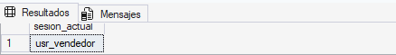
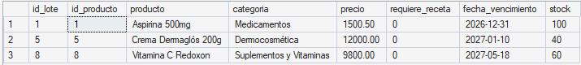
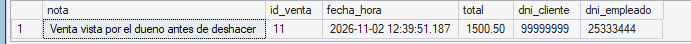
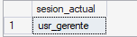
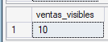
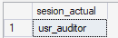
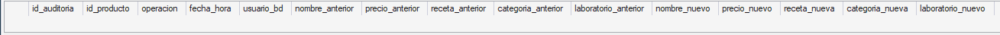
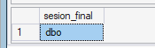
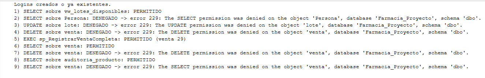

# Seguridad

## 1. Definición y objetivo

La seguridad de una base de datos controla **quién puede entrar** (autenticación) y **qué puede hacer** (autorización). En SQL Server se organiza en capas:

| Concepto | Qué es |
|---|---|
| **Login** | Cuenta para conectarse al **servidor** (autenticación) |
| **Usuario** | Representación del login dentro de **una base de datos** |
| **Rol** | Grupo de permisos que se asigna a varios usuarios |
| **Permiso** | `GRANT` (otorga), `DENY` (prohíbe, tiene prioridad) y `REVOKE` (quita lo otorgado o prohibido) |

**Principio de mínimo privilegio:** cada usuario recibe únicamente los permisos que necesita para su trabajo, y nada más.

## 2. Ventajas y aplicaciones

- **Protección de datos personales** (DNI, teléfono, correo de clientes y empleados).
- **Integridad:** se evita que alguien modifique stock, precios o ventas de forma directa y sin control.
- **Separación de funciones:** el vendedor vende, el gerente controla, el auditor solo consulta.
- **Menos superficie de ataque:** si un usuario se ve comprometido, el daño queda limitado a sus permisos.

## 3. Implementación en SQL Server Express

Se definen tres perfiles, cada uno con su login, su usuario y su rol:

| Perfil | Login / Usuario / Rol |
|---|---|
| Vendedor | `lg_vendedor` / `usr_vendedor` / `rol_vendedor` |
| Gerente | `lg_gerente` / `usr_gerente` / `rol_gerente` |
| Auditor | `lg_auditor` / `usr_auditor` / `rol_auditor` |

Técnicas aplicadas:

- **Vista restrictiva** (`vw_lotes_disponibles`): el vendedor ve solo los lotes vigentes con stock, sin datos personales ni de proveedores.
- **Acceso solo mediante procedimientos:** el vendedor no puede modificar `venta`, `detalle_venta`, `lote` ni `pago` directamente; solo puede ejecutar `sp_RegistrarVentaCompleta`. Funciona por el **encadenamiento de propiedad**: como el procedimiento y las tablas pertenecen al mismo dueño (`dbo`), SQL Server no vuelve a verificar los permisos sobre las tablas que el procedimiento usa.
- **Permiso sobre el tipo tabla:** para usar el parámetro `tipo_detalle_venta` se necesita `EXECUTE` sobre el tipo.
- **Permiso por columna:** el gerente puede modificar únicamente `Producto.precio`.

> **Portabilidad:** crear logins requiere permisos de `sysadmin` o `ALTER ANY LOGIN`. Si el usuario que ejecuta el script no los tiene, `scripts.sql` omite los logins y crea los usuarios `WITHOUT LOGIN`. La demostración funciona igual porque simula cada sesión con `EXECUTE AS USER`. Además, para conectarse con esos logins hay que habilitar el modo mixto en SQL Server; la demo no lo necesita. Para usar `EXECUTE AS` hay que ejecutar como `dbo` o tener permiso `IMPERSONATE` sobre los usuarios.

### Matriz de permisos

| Objeto | `rol_vendedor` | `rol_gerente` | `rol_auditor` |
|---|---|---|---|
| `vw_lotes_disponibles` | SELECT | – | – |
| `sp_RegistrarVentaCompleta` (y tipo `tipo_detalle_venta`) | EXECUTE | EXECUTE | – |
| `sp_ReporteVentasPorVendedor` | – | EXECUTE | – |
| `venta`, `detalle_venta`, `pago`, `lote` | DENY todo | SELECT; DENY DELETE (`venta`, `detalle_venta`) | – |
| `Persona`, `Cliente`, `Empleado` | DENY todo | SELECT | – |
| `Producto` | – | SELECT y UPDATE solo de `precio` | – |
| `auditoria_producto` | – | – | SELECT |

El gerente recibe permisos `SELECT` solo sobre las tablas enumeradas en la matriz, no sobre todo `dbo`. Así, las tablas nuevas no quedan accesibles automáticamente. El script revoca también el permiso de esquema amplio si se había aplicado en una ejecución anterior.

## 4. Caso concreto aplicado al sistema de ventas

En la farmacia, el **vendedor** atiende en el mostrador: necesita ver qué lotes hay y registrar la venta, pero no debería poder cambiar el stock a mano, borrar ventas ni ver los datos personales de clientes y empleados (RN.01, RN.03 y RN.08). El **gerente** controla el negocio y puede ajustar precios, pero no borrar ventas. El **auditor** solo revisa la tabla de auditoría de la Etapa V.

## 5. Cómo ejecutar la demostración

1. Tener creada y cargada la base `Farmacia_Proyecto` con el DDL y el DML del proyecto.
2. Haber ejecutado antes `etapa_v/procedimientos_funciones/scripts.sql` y `etapa_v/triggers_auditoria/scripts.sql`, porque la demo usa `sp_RegistrarVentaCompleta`, `tipo_detalle_venta`, `sp_ReporteVentasPorVendedor` y `auditoria_producto`.
3. Abrir `scripts.sql` en SQL Server Management Studio y ejecutarlo completo, de arriba hacia abajo.
4. Revisar los mensajes de la pestaña **Messages** y los resultados de cada `SELECT`, y compararlos con la sección 6. Las pruebas denegadas imprimen el número y el mensaje del error (por ejemplo, error 229); guardá una captura donde se vean las pruebas 1 a 9, en ese orden.

> La venta de prueba se registra dentro de una transacción que se deshace al final (`ROLLBACK`), por lo que la demo se puede ejecutar varias veces sin dejar ventas acumuladas.

## 6. Resultados esperados

| Prueba | Resultado |
|---|---|
| 1) Vendedor consulta `vw_lotes_disponibles` | PERMITIDO |
| 2) Vendedor consulta `Persona` | DENEGADO (error 229: permiso SELECT denegado) |
| 3) Vendedor hace `UPDATE` sobre `lote` | DENEGADO (error 229) |
| 4) Vendedor hace `DELETE` sobre `venta` | DENEGADO (error 229) |
| 5) Vendedor ejecuta `sp_RegistrarVentaCompleta` | PERMITIDO (la venta se registra y luego se deshace) |
| 6) Gerente consulta `venta` | PERMITIDO |
| 7) Gerente hace `DELETE` sobre `venta` | DENEGADO (error 229) |
| 8) Auditor consulta `auditoria_producto` | PERMITIDO |
| 9) Auditor consulta `venta` | DENEGADO (error 229) |

Al final, `sesion_final` vuelve al usuario original (`dbo`).

## 7. Evidencias

### 7.1 Sesión del vendedor

`USER_NAME()` devuelve `usr_vendedor` después de `EXECUTE AS USER`.

### 7.2 Lotes disponibles para el vendedor

El vendedor consulta la vista `vw_lotes_disponibles` sin acceder a las tablas base ni a los datos personales.

### 7.3 Venta registrada por el vendedor

La venta se registra a través de `sp_RegistrarVentaCompleta` y se muestra antes de deshacerla.

### 7.4 Sesión del gerente

`USER_NAME()` devuelve `usr_gerente`.

### 7.5 Ventas visibles para el gerente

El gerente puede leer la tabla `venta`, pero no borrarla.

### 7.6 Sesión del auditor

`USER_NAME()` devuelve `usr_auditor`.

### 7.7 Auditoría visible para el auditor

El auditor solo puede consultar `auditoria_producto`; el acceso a `venta` queda denegado.

### 7.8 Vuelta al usuario original

Después del último `REVERT`, `USER_NAME()` vuelve a `dbo`.

### 7.9 Permisos denegados

Las nueve pruebas se muestran en orden. Los intentos denegados (2, 3, 4, 7 y 9) devuelven el error 229; las operaciones permitidas (1, 5, 6 y 8) también quedaron verificadas en la ejecución.

## 8. Reglas de negocio cubiertas

| Regla | Dónde se aplica |
|---|---|
| RN.01 | El vendedor no puede modificar el stock directamente; solo lo hace `sp_RegistrarVentaCompleta` |
| RN.03 | El vendedor puede registrar una venta sin cliente y el procedimiento resuelve el Consumidor Final |
| RN.08 | El vendedor no puede ver ni modificar los datos personales de clientes y empleados |
