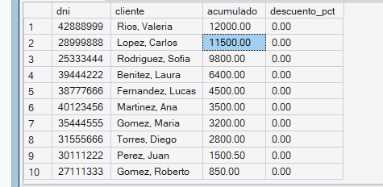
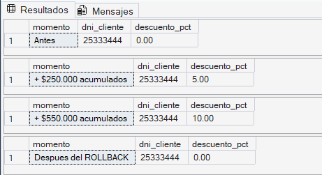
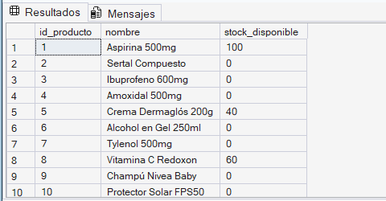
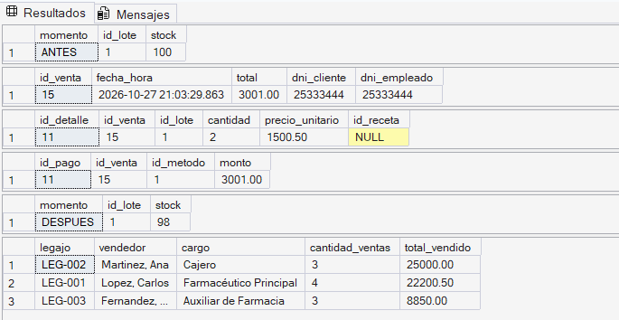

# Procedimientos y funciones almacenadas

## 1. Definición y objetivo

Un **procedimiento almacenado** (*stored procedure*) es un programa SQL que se guarda dentro de la base de datos con un nombre y se ejecuta con una sola instrucción (`EXEC`). Puede recibir parámetros, ejecutar muchas operaciones (consultas, inserciones, actualizaciones) y devolver resultados.

Una **función almacenada** (*function*) es una rutina que recibe parámetros y **devuelve un valor** (función escalar) o **una tabla** (función de tabla). A diferencia del procedimiento, se puede usar dentro de un `SELECT`, como si fuera una columna más.

| | Procedimiento | Función |
|---|---|---|
| Se invoca con | `EXEC` | dentro de una consulta (`SELECT dbo.fn(...)`) |
| Devuelve | conjuntos de resultados y parámetros de salida | un valor o una tabla |
| Puede modificar datos | Sí | No (solo consulta) |
| Uso típico | procesos completos (registrar una venta) | cálculos reutilizables (descuentos, stock) |

**Objetivo:** concentrar la lógica de negocio dentro de la base de datos para que todas las aplicaciones y usuarios la usen de la misma forma.

## 2. Ventajas y aplicaciones

- **Reutilización:** la lógica se escribe una vez y se invoca desde cualquier lugar.
- **Menos código repetido y más mantenibilidad:** si cambia una regla (por ejemplo, el porcentaje de descuento), se modifica en un solo objeto.
- **Centralización de reglas de negocio:** las reglas RN.01, RN.02, RN.04 y RN.06 se validan siempre, sin depender de que cada programa las recuerde.
- **Seguridad:** se puede permitir que un usuario ejecute el procedimiento sin darle acceso directo a las tablas.
- **Rendimiento:** una sola llamada reemplaza varias consultas enviadas por separado, y el motor reutiliza el plan de ejecución.

## 3. Implementación en el sistema

Objetos creados:

| Objeto | Tipo | Qué hace |
|---|---|---|
| `dbo.fn_CalcularDescuentoCliente` | Función escalar | Devuelve el % de descuento según lo acumulado en compras del cliente |
| `dbo.fn_StockDisponible` | Función escalar | Suma el stock de los lotes **no vencidos** de un producto |
| `dbo.tipo_detalle_venta` | Tipo tabla | Permite enviar todos los renglones de una venta en un solo parámetro |
| `dbo.sp_RegistrarVentaCompleta` | Procedimiento | Registra encabezado, detalle, stock, total y pago en una única operación |
| `dbo.sp_ReporteVentasPorVendedor` | Procedimiento | Reporte de ventas por vendedor en un rango de fechas (consulta 2.a de la Etapa IV) |

**Orden de ejecución:** primero las funciones y luego los procedimientos, porque el procedimiento de venta usa la función de descuento. Todo el código ejecutable está en `scripts.sql`.

## 4. Caso concreto aplicado al sistema de ventas

**Problema de negocio:** registrar una venta completa sin que el usuario tenga que ejecutar muchas consultas, cumpliendo las reglas de negocio y premiando a los clientes frecuentes.

`sp_RegistrarVentaCompleta` recibe el vendedor, el método de pago, el cliente (opcional: si es `NULL` se resuelve al cliente genérico Consumidor Final, dni 99999999, RN.03) y los renglones de la venta, y realiza **en una única transacción**:

1. Valida los datos y las reglas: lote vencido (RN.02) y producto bajo receta sin receta (RN.06).
2. Calcula el descuento del cliente con `fn_CalcularDescuentoCliente`.
3. Inserta el encabezado en `venta`.
4. Inserta los renglones en `detalle_venta` guardando el **precio histórico** (RN.04).
5. Descuenta el stock del lote (RN.01) con un `UPDATE` condicionado: solo descuenta si alcanza.
6. Calcula el total y registra el `pago` (RN.05).
7. Confirma con `COMMIT`; ante cualquier error hace `ROLLBACK`.

**Decisiones de diseño:**

- El modelo no tiene una columna de descuento, por lo que el descuento se refleja en el `precio_unitario` efectivamente cobrado. Así `venta.total` sigue siendo igual a la suma de los renglones y la consulta de control de la Etapa IV sigue sin mostrar diferencias.
- El stock se controla por **lote** (donde está guardado en el modelo), no por producto.
- Los renglones se envían con un **parámetro de tipo tabla**, lo que permite vender varios productos en una sola llamada.
- Los umbrales de la función de descuento ($200.000 y $500.000) son los de la guía de la cátedra; se pueden ajustar editando la función.

## 5. Cómo ejecutar la demostración

1. Tener creada y cargada la base `Farmacia_Proyecto` con el DDL y el DML del proyecto.
2. Abrir `scripts.sql` en SQL Server Management Studio.
3. Ejecutarlo completo, de arriba hacia abajo. El archivo está dividido en tres secciones: funciones, procedimientos y demostración.
4. Revisar los resultados de cada `SELECT` y compararlos con la sección 6.

> La demostración de procedimientos usa `@limpiar = 1`: al final elimina la venta de prueba y restituye el stock, por lo que se puede ejecutar varias veces sin dejar datos acumulados.

## 6. Resultados esperados

- El primer `SELECT` de `demo_funciones` lista a cada cliente con su acumulado de compras y su descuento (con pocos datos de prueba, `0.00` para todos).
- En la simulación el descuento pasa de `0.00` a `5.00` (acumulado > $200.000) y luego a `10.00` (acumulado > $500.000). Tras el `ROLLBACK` vuelve al valor original.
- El último `SELECT` de `demo_funciones` muestra el stock vendible de cada producto (lotes no vencidos).
- En `demo_procedimientos`, el stock del lote baja en 2 unidades (`ANTES` vs. `DESPUES`).
- Queda **una** fila en `venta`, **una** en `detalle_venta` (cantidad 2, con el precio del producto) y **una** en `pago` cuyo monto coincide con `venta.total`.
- `sp_ReporteVentasPorVendedor` devuelve el total vendido por cada vendedor.
- Con `@limpiar = 1` la venta de prueba se elimina y el stock se restituye al final.

## 7. Evidencias

### 7.1 Descuento actual por cliente

Lista de clientes con su acumulado de compras y el porcentaje que devuelve la función.

### 7.2 Simulación de descuento

Se agregan compras dentro de una transacción: el descuento sube a 5 % y luego a 10 %, y vuelve al valor original después del `ROLLBACK`.

### 7.3 Stock vendible por producto

Suma de stock de los lotes no vencidos de cada producto.

### 7.4 Registro de una venta completa

Resultado de `sp_RegistrarVentaCompleta`: venta, detalle, pago y variación de stock.

## 8. Reglas de negocio cubiertas

| Regla | Dónde se aplica |
|---|---|
| RN.01 | Descuento de stock por lote dentro de `sp_RegistrarVentaCompleta` |
| RN.02 | `fn_StockDisponible` y validación de lote vencido en el procedimiento |
| RN.03 | Resolución del cliente genérico Consumidor Final (dni 99999999) |
| RN.04 | Precio histórico guardado en `detalle_venta` |
| RN.05 | Registro del pago en `pago` |
| RN.06 | Validación de receta para productos que la requieren |
