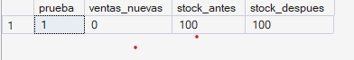
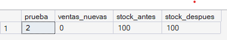
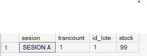
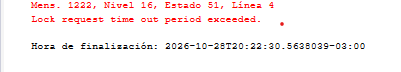
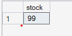
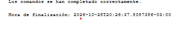
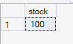

# Manejo de transacciones

## 1. Definición y objetivo

Una **transacción** es un conjunto de operaciones SQL que se ejecuta como **una única unidad lógica de trabajo**: o se completan todas, o no se aplica ninguna. Si una operación falla, las anteriores se deshacen. Esto garantiza las propiedades **ACID**:

| Propiedad | Significado | Ejemplo en la farmacia |
|---|---|---|
| **A**tomicidad | Todo o nada | O se registran venta, detalle y stock, o no se registra nada |
| **C**onsistencia | La base pasa de un estado válido a otro válido | El stock nunca queda negativo |
| **A**islamiento | Transacciones simultáneas no se interfieren | Dos vendedores no pueden vender la misma última unidad |
| **D**urabilidad | Lo confirmado persiste aunque falle el servidor | Una venta confirmada no se pierde |

**Instrucciones principales en SQL Server:** `BEGIN TRANSACTION` (inicia), `COMMIT TRANSACTION` (confirma), `ROLLBACK TRANSACTION` (deshace), `TRY … CATCH` (captura errores), `THROW` (lanza un error propio) y `@@TRANCOUNT` (cantidad de transacciones abiertas).

## 2. Ventajas y aplicaciones

- Evita **información incompleta o inconsistente** ante fallas (cortes de luz, errores, datos inválidos).
- Permite aplicar reglas de negocio con la garantía de que, si una no se cumple, no queda ningún cambio a medias.
- Es la base de cualquier proceso que toque varias tablas: ventas, devoluciones, ingreso de lotes.

## 3. Implementación en el sistema

Una venta involucra varias tablas: `venta`, `detalle_venta`, `lote` (donde se guarda el stock) y `pago`. Se implementa con el patrón:

```sql
BEGIN TRY
    BEGIN TRANSACTION
        -- 1) crear venta   2) crear detalle   3) descontar stock (si no alcanza: THROW)
    COMMIT TRANSACTION
END TRY
BEGIN CATCH
    ROLLBACK TRANSACTION   -- se deshace todo
END CATCH
```

El mismo patrón está incorporado dentro de `sp_RegistrarVentaCompleta`, que además usa `SET XACT_ABORT ON` para que cualquier error de ejecución cancele la transacción.

El control de stock se hace con un `UPDATE` condicionado (`WHERE stock >= @cantidad`): si no se modifica ninguna fila, el stock era insuficiente y se lanza un error. Esta forma es atómica y soporta el **aislamiento**: si dos vendedores intentan vender la última unidad al mismo tiempo, solo uno logra descontarla.

SQL Server usa por defecto el nivel de aislamiento `READ COMMITTED`: mientras una transacción modifica una fila sin confirmar, ninguna otra sesión puede leer ese dato (queda esperando el bloqueo). Esto evita las **lecturas sucias**, es decir, leer cambios que después podrían deshacerse con un `ROLLBACK`.

## 4. Caso concreto aplicado al sistema de ventas

**Escenario:** un cliente compra unidades de un producto. La operación debe (1) crear la venta, (2) crear el detalle y (3) descontar stock.

**Si no hay stock suficiente:** no se registra la venta, no se registra el detalle y no se modifica el stock (RN.01).

Se realizan dos pruebas sobre el mismo lote:

| Prueba | Cantidad | Resultado esperado |
|---|---|---|
| 1 – Correcta | 2 unidades (stock suficiente) | `COMMIT`: venta registrada y stock descontado |
| 2 – Incorrecta | stock + 1 (stock insuficiente) | `ROLLBACK`: no queda ningún registro parcial |

La prueba 2 es la que demuestra la **atomicidad**: la venta y el detalle ya habían sido insertados cuando se detectó la falta de stock, y aun así el `ROLLBACK` los deshace.

## 5. Cómo ejecutar la demostración

La carpeta contiene dos scripts porque las demostraciones tienen requisitos distintos.

### 5.1 Atomicidad (una sola sesión)

1. Abrir `scripts.sql` en SQL Server Management Studio.
2. Ejecutarlo completo.
3. Comparar los resultados con la tabla de la sección 6.

La demostración usa `@limpiar = 1`: al final elimina la venta de la prueba 1 y restituye el stock, por lo que se puede ejecutar varias veces.

### 5.2 Aislamiento (dos sesiones)

Abrir `scripts_aislamiento.sql`. Esta parte **no se ejecuta de una sola vez**: necesita dos ventanas de consulta abiertas al mismo tiempo.

1. En la **ventana A**, ejecutar el **PASO 1** (abre la transacción y modifica el stock sin confirmar). No ejecutar todavía `COMMIT` ni `ROLLBACK`.
2. En la **ventana B**, ejecutar el **PASO 2** (lectura normal). Debe quedar esperando y fallar a los 5 segundos con el error 1222.
3. En la **ventana B**, ejecutar el **PASO 3** (`WITH (NOLOCK)`) para ver la lectura sucia.
4. En la **ventana A**, ejecutar el **PASO 4** (`ROLLBACK`).
5. En la **ventana B**, ejecutar el **PASO 5** (lectura normal). Ahora responde con el stock original.

## 6. Resultados esperados

### 6.1 Atomicidad

| Prueba | Mensaje esperado | `ventas_nuevas` | `stock_despues` |
|---|---|---:|---|
| 1 | `COMMIT: venta N registrada.` | 1 | `stock_antes − 2` |
| 2 | `ROLLBACK: Stock insuficiente: se cancela la venta.` | 0 | `stock_antes` (sin cambios) |

Con `@limpiar = 1`, al final se elimina la venta de la prueba 1 y se restituye el stock, dejando la base como estaba.

### 6.2 Aislamiento

| Paso | Sesión | Resultado |
|---|---|---|
| 1 | A | `trancount = 1` y el stock del lote 1 con una unidad menos (sin confirmar) |
| 2 | B (lectura normal) | Queda esperando y a los 5 segundos falla con el error 1222 (*Lock request time out period exceeded*): no puede ver un dato sin confirmar |
| 3 | B (`WITH (NOLOCK)`) | Lee el stock modificado por A (lectura sucia); se muestra para contrastar y **no se recomienda** en ventas |
| 4 | A | `ROLLBACK`: se deshace el cambio |
| 5 | B (lectura normal) | Responde de inmediato con el stock original |

Esto demuestra el **aislamiento**: una transacción no expone sus cambios a otras sesiones hasta que se confirman con `COMMIT`.

## 7. Evidencias

### 7.1 Atomicidad: prueba correcta

`COMMIT`: la venta se registra y el stock baja en 2 unidades.



### 7.2 Atomicidad: prueba incorrecta

`ROLLBACK`: no queda ningún registro parcial y el stock no cambia.



### 7.3 Aislamiento: sesión A abre la transacción

La sesión A modifica el stock sin confirmar (`trancount = 1`).



### 7.4 Aislamiento: sesión B queda bloqueada

La lectura normal de la sesión B espera y falla por timeout: no puede leer un dato sin confirmar.



### 7.5 Aislamiento: lectura sucia con NOLOCK

La sesión B lee el cambio no confirmado. Se muestra solo para contrastar.



### 7.6 Aislamiento: sesión A deshace la transacción

`ROLLBACK` en la sesión A.



### 7.7 Aislamiento: sesión B vuelve a leer

La lectura normal responde con el stock original.



## 8. Reglas de negocio cubiertas

| Regla | Dónde se aplica |
|---|---|
| RN.01 | El stock se descuenta solo si alcanza; si no, `ROLLBACK` |
| RN.03 | La demostración usa el cliente genérico Consumidor Final (dni 99999999) |
